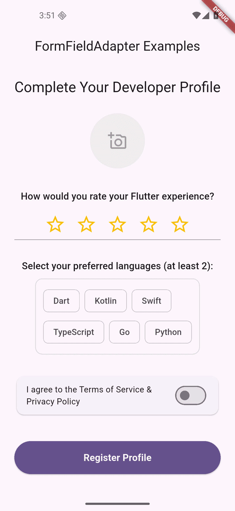

# FormFieldAdapter

[](https://pub.dev/packages/form_field_adapter)
[](https://pub.dev/packages/form_field_adapter)
[](https://github.com/hbsgujjar111/form_field_adapter/blob/master/LICENSE)



An interactive, focus-aware `FormField` wrapper designed for Flutter.

`FormFieldAdapter` simplifies turning any custom input widget (such as rating selectors,
multi-select tag chips, map pin pickers, or image uploads) into a fully integrated form field with
validation, animated visual feedback, and zero boilerplate.

---

## Features

* **State-Based Animated Decorations**: Smoothly morphs between four custom `Decoration` states (
  *Normal*, *Focused*, *Error*, and *Focused Error*).
* **Shake Animation**: Naturally shakes the input container horizontally when validation fails to
  instantly capture user attention. Skipped automatically when the system's reduce-motion setting
  is on.
* **Tunable Shake**: Change the shake distance with `shakeOffset` and its length with `shakeDuration`.
* **Haptic Feedback**: Triggers a subtle, light device vibration when a field becomes invalid and
  every time an explicit validation (such as `FormState.validate()`) fails again.
* **Focus Node Integration**: Listens to a standard Flutter `FocusNode` to trigger active/idle
  styling changes. You attach the same node to a `Focus` widget inside `builder` (see below).
* **Accessible Errors**: Error text is announced to screen readers as a live region.
* **Scroll to the First Error**: Opt in with `ensureVisibleOnError` to scroll the topmost failing
  field into view when validation fails.
* **Disabled and Derived Styles**: A `disabledDecoration` for disabled fields, and an automatic
  error look derived from your normal decoration when you don't provide `errorDecoration`.
* **Flexible Error Placement**: Choose whether standard error messages should appear above the
  field, below the field, or be hidden entirely (to display custom alert layouts instead).
* **Flexible Layout Alignment**: Align the entire wrapper and its error text to the `start`,
  `center`, or `end` to support centered widgets like profile avatars and rating bars.
* **Automatic Theme Integration**: Falls back to your app's `ThemeData` (error and primary colors,
  and `inputDecorationTheme.errorStyle` for the error text) if custom values aren't passed.
* **Works with a plain `Form`**: No extra form wrapper or dependencies. RTL layouts are supported.
* **Universal Compatibility**: Works on mobile, tablet, desktop, and web.

---

## Installation

Add `form_field_adapter` to your `pubspec.yaml` dependencies:

```yaml
dependencies:
  form_field_adapter: ^1.1.0
```


And run:

```bash
flutter pub get
```

---

## Quick Start

Wrap any interactive widget inside the `FormFieldAdapter` to connect it with your parent `Form`:

```dart
import 'package:flutter/material.dart';
import 'package:form_field_adapter/form_field_adapter.dart';

class RatingForm extends StatefulWidget {
  const RatingForm({super.key});

  @override
  State<RatingForm> createState() => _RatingFormState();
}

class _RatingFormState extends State<RatingForm> {
  final _formKey = GlobalKey<FormState>();
  final _focusNode = FocusNode();
  int _userRating = 0;

  @override
  void dispose() {
    _focusNode.dispose();
    super.dispose();
  }

  @override
  Widget build(BuildContext context) {
    return Form(
      key: _formKey,
      child: Column(
        children: [
          FormFieldAdapter<int>(
            initialValue: _userRating,
            focusNode: _focusNode,
            validator: (value) =>
            (value == null || value < 3) ? 'Must rate at least 3 stars!' : null,
            onSaved: (value) => _userRating = value ?? 0,
            builder: (state) {
              // Attach the same focus node here, or the focused styles never apply.
              return Focus(
                focusNode: _focusNode,
                child: Row(
                  mainAxisAlignment: MainAxisAlignment.center,
                  children: List.generate(5, (index) {
                    return IconButton(
                      icon: Icon(
                        index < (state.value ?? 0) ? Icons.star : Icons.star_border,
                        color: Colors.amber,
                      ),
                      onPressed: () {
                        state.didChange(index + 1);
                        _focusNode.requestFocus();
                      },
                    );
                  }),
                ),
              );
            },
          ),
          ElevatedButton(
            onPressed: () {
              if (_formKey.currentState!.validate()) {
                _formKey.currentState!.save();
                debugPrint('Validation passed! Rating is $_userRating');
              }
            },
            child: const Text('Submit'),
          ),
        ],
      ),
    );
  }
}
```

---

## Advanced Customization

For full-control designs, wrap your custom widgets inside a builder method to satisfy your design
requirements:

```dart
import 'package:flutter/material.dart';
import 'package:form_field_adapter/form_field_adapter.dart';

Widget buildCustomAdapter(FocusNode myFocusNode) {
  return FormFieldAdapter<String?>(
    focusNode: myFocusNode,
    errorPosition: ErrorPosition.top,
    // Places the error text above the input
    enableHaptics: true,
    // Enable device vibrations
    enableShake: true,
    // Enable failure shake animation

    // Design completely custom border styles
    normalDecoration: BoxDecoration(
      borderRadius: BorderRadius.circular(8),
      border: Border.all(color: Colors.grey.shade300),
    ),
    focusedDecoration: BoxDecoration(
      borderRadius: BorderRadius.circular(8),
      border: Border.all(color: Colors.deepPurple, width: 2),
    ),
    errorDecoration: BoxDecoration(
      borderRadius: BorderRadius.circular(8),
      border: Border.all(color: Colors.red, width: 1.5),
    ),
    builder: (state) {
      return const SizedBox.shrink(); // Replace with your custom widget
    },
  );
}
```

---

## Validation Feedback

* **Shake and haptics** fire when a field becomes invalid and again on every explicit validation
  that fails (for example a second tap on *Submit*). While the user types, an error that is already
  showing does not repeat the feedback. Both are skipped for disabled fields, and the shake is also
  skipped when the system's reduce-motion setting is on.
* **Error look.** If you set `normalDecoration` (or `focusedDecoration`) as a `BoxDecoration` with a
  `Border` or `BorderDirectional` but no `errorDecoration`, the error state reuses it with every
  visible border side recolored in the theme's error color. Any other decoration without a border
  is reused unchanged, so provide an `errorDecoration` if you want a visible error style there.
* **Scrolling.** Set `ensureVisibleOnError: true` on the fields that should scroll into view. When
  an explicit validation fails, only the topmost failing field among them is revealed. Errors that
  appear while typing do not scroll. The scroll is animated, or instant when the system asks to
  reduce motion.
* **Renamed parameter.** `autovalidateMode` replaces `autoValidateMode`, which still works but is
  deprecated and will be removed in 2.0.0.

---

## Properties

| Property                 | Type                                     | Default                              | Description                                                                                                                                                 |
|:-------------------------|:-----------------------------------------|:-------------------------------------|:------------------------------------------------------------------------------------------------------------------------------------------------------------|
| `builder`                | `Widget Function(FormFieldState<T>)`     | *Required*                           | Renders your custom input widget.                                                                                                                           |
| `initialValue`           | `T?`                                     | `null`                               | Initial value of the field. Restored by `FormState.reset()`.                                                                                                |
| `validator`              | `String? Function(T?)?`                  | `null`                               | Returns an error message, or `null` when the value is valid.                                                                                                |
| `onSaved`                | `void Function(T?)?`                     | `null`                               | Called by `FormState.save()`.                                                                                                                               |
| `autovalidateMode`       | `AutovalidateMode?`                      | `AutovalidateMode.onUserInteraction` | When to validate. Differs from Flutter's default (`disabled`). `autoValidateMode` is the deprecated old spelling; if both are set, `autovalidateMode` wins. |
| `onChanged`              | `ValueChanged<T?>?`                      | `null`                               | Called with the new value after `didChange`. Not called by `reset()`.                                                                                       |
| `onReset`                | `VoidCallback?`                          | `null`                               | Forwarded to `FormField`. Called by `FormState.reset()`.                                                                                                    |
| `forceErrorText`         | `String?`                                | `null`                               | Forwarded to `FormField`. Shows this error from outside the validator, for example a server error.                                                          |
| `restorationId`          | `String?`                                | `null`                               | Forwarded to `FormField` for state restoration.                                                                                                             |
| `enabled`                | `bool`                                   | `true`                               | Forwarded to `FormField`: when `false`, automatic validation is off, but `FormState.validate()` still validates it. Shake and haptics are skipped.          |
| `focusNode`              | `FocusNode?`                             | `null`                               | Listened to for focus changes. Attach the same node to a `Focus` widget in `builder`.                                                                       |
| `normalDecoration`       | `Decoration?`                            | `null`                               | Style applied when the field is valid and not focused.                                                                                                      |
| `focusedDecoration`      | `Decoration?`                            | `null`                               | Style applied when the field is valid and focused. Falls back to `normalDecoration`.                                                                        |
| `errorDecoration`        | `Decoration?`                            | `null`                               | Style applied when the field has a validation error and is not focused. Without it, a recolored copy of `normalDecoration` is used.                         |
| `focusedErrorDecoration` | `Decoration?`                            | `null`                               | Style applied when the field has an error and is focused. Falls back to `errorDecoration`, then a recolored `focusedDecoration`.                            |
| `disabledDecoration`     | `Decoration?`                            | `null`                               | Style applied when `enabled` is `false`. Wins over every other state. Without it, the usual states apply.                                                   |
| `decorationPlacement`    | `DecorationPlacement`                    | `DecorationPlacement.background`     | Renders decoration behind (`background`) or as a stack overlay (`foreground`).                                                                              |
| `enableShake`            | `bool`                                   | `true`                               | Triggers a horizontal shake on validation error. Skipped when reduce-motion is on.                                                                          |
| `enableHaptics`          | `bool`                                   | `true`                               | Triggers light haptic feedback on devices on validation error.                                                                                              |
| `shakeDuration`          | `Duration`                               | `350ms`                              | Length of the shake animation.                                                                                                                              |
| `shakeOffset`            | `double`                                 | `8.0`                                | Largest horizontal movement of the shake, in logical pixels.                                                                                                |
| `ensureVisibleOnError`   | `bool`                                   | `false`                              | When an explicit validation fails, scrolls the topmost failing field with this flag into view.                                                              |
| `animationDuration`      | `Duration`                               | `200ms`                              | Transition duration between the decoration states.                                                                                                          |
| `crossAxisAlignment`     | `CrossAxisAlignment`                     | `CrossAxisAlignment.start`           | Aligns the outer layout container (`start`, `center`, or `end`).                                                                                            |
| `errorTextAlign`         | `TextAlign?`                             | `null`                               | Custom error text alignment. Automatically matches `crossAxisAlignment` if left null.                                                                       |
| `errorPosition`          | `ErrorPosition`                          | `ErrorPosition.bottom`               | Location of the error message (`top`, `bottom`, or `none`).                                                                                                 |
| `errorTextStyle`         | `TextStyle?`                             | `null`                               | Typography for the validation error message.                                                                                                                |
| `errorPadding`           | `EdgeInsetsGeometry?`                    | `null`                               | Custom margins around the error message. Default: 6 px above/below and 4 px at the start.                                                                   |
| `errorBuilder`           | `Widget Function(BuildContext, String)?` | `null`                               | Completely custom render callback for the error layout.                                                                                                     |

> **Tip:** keep the border widths of your custom decorations equal across states. A `Border` adds to the
> field's size, so different widths make the layout jump when focus or error state changes.

---

## Platforms Supported

* iOS
* Android
* Web
* macOS
* Windows
* Linux

---

## Contributions Welcome

Found a bug or want to improve this widget? Open an issue or pull request on GitHub:
**[github.com/hbsgujjar111/form_field_adapter](https://github.com/hbsgujjar111/form_field_adapter)**

---

## License

This project is licensed under the MIT License - see the LICENSE file for details.